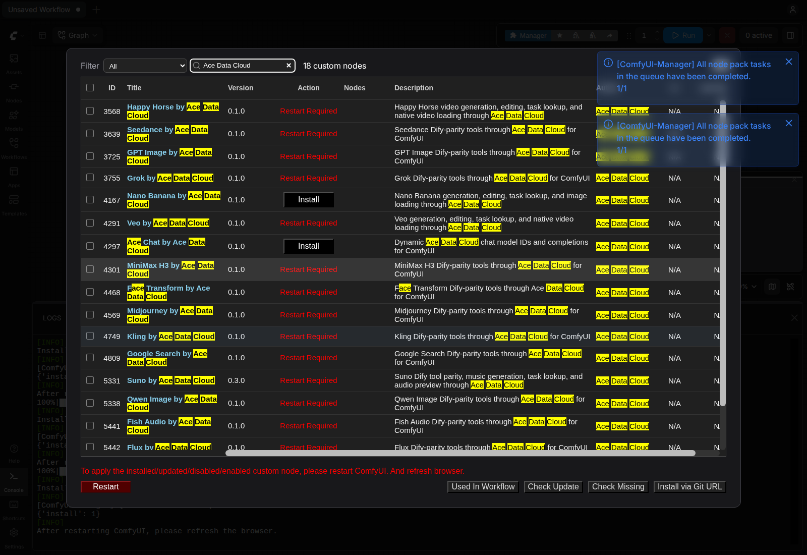
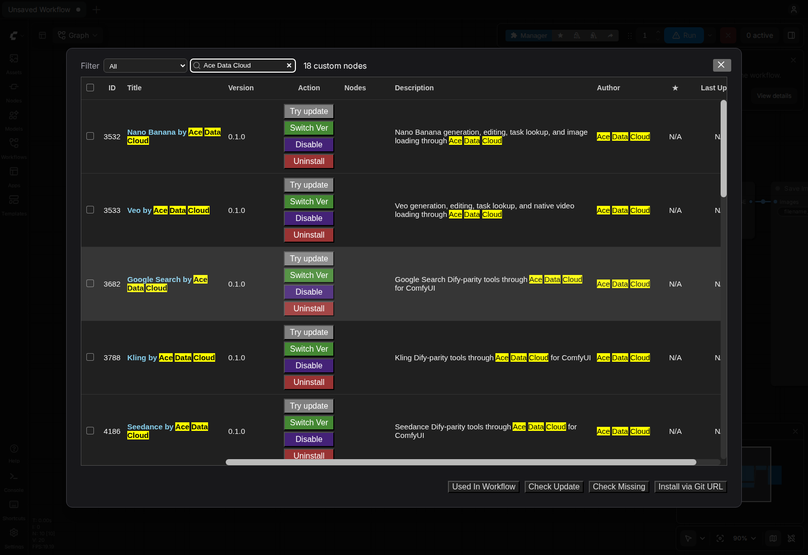

# Ace Data Cloud Nano Banana ComfyUI 节点

通过 Ace Data Cloud 的 Nano Banana 云 API 生成或编辑图片，按**同一个任务 ID**查询终态，再将成品加载为 ComfyUI 标准 `IMAGE`。无需本地模型或显卡；生成与编辑会按[当前价格](https://platform.acedata.cloud/models?utm_source=comfyui&utm_medium=referral&utm_campaign=evergreen&utm_content=nanobananacomfyui_readme_zh_cn_pricing)扣除 Ace Data Cloud Credits。

[English](../README.md) · [控制台](https://platform.acedata.cloud/console/applications?utm_source=comfyui&utm_medium=referral&utm_campaign=evergreen&utm_content=nanobananacomfyui_readme_zh_cn_api_key)

节点包括生成、编辑、单任务查询、批量任务查询、单图加载和多图批量加载。生成和编辑只提交一次收费请求；查询及下载不会重新生成。包覆盖 Dify Nano Banana 插件目前列出的 9 个模型 ID：`nano-banana`、`nano-banana-2-lite`、`nano-banana-2`、`nano-banana-2.1`、`nano-banana-pro` 及除 `2.1` 外上述四种模型的 `:official` 版本。不同模型的价格与分辨率能力可能不同；`nano-banana` 和 `nano-banana-2-lite` 只支持 `1K`。

## 安装与密钥

## 官方安装

打开官方 [Nano Banana by Ace Data Cloud Registry 页面](https://registry.comfy.org/nodes/nano-banana)，或在 **Manager → Custom Nodes Manager** 搜索 **Nano Banana**；找不到时再搜 **Ace Data Cloud**。选择 **Nano Banana by Ace Data Cloud**，核对发布者 **acedatacloud** 和源码仓库 [`AceDataCloud/NanoBananaComfyUI`](https://github.com/AceDataCloud/NanoBananaComfyUI)，再点击 **Install**。在 **Select Version** 版本对话框明确选择已批准的 Registry 稳定版 **0.1.0**；普通对话框可能默认高亮 **nightly**，本教程不要直接接受该选项。保留依赖自动安装。出现 **Restart Required** 后重启 ComfyUI，并刷新浏览器。Registry ID 为 `nano-banana`。

以上原图来自 **2026-10-16、Linux ComfyUI 0.41.0** 的发布者品牌搜索安装验收，不是本轮新生成，也不是服务词搜索实拍；见[图片来源与边界](screenshot-sources.json)。

这条 Registry 稳定版安装路径已于 **2026-10-16 在原版 Linux CPU ComfyUI 0.41.0** 验证；该次安装验收没有提交生成或聊天请求。更新的宿主版本及每个收费动作仍需分别验证，模型可用性与价格以当前服务规则为准。

## 注册并获取 API Token

### 复制或创建自己的 API Token

Ace 应用页与其他集成共用：图中 **1** 复制已有 Token，**2** 打开**管理 Key**，再选**创建**。新账户先注册/登录并初始化**通用应用**；确认本服务权限、当前价格、余额、有效期和允许的 API 限制。

以上是 **2026-10-08** 的真实脱敏 Ace 控制台原图，复用自 SunoDify；第二图示例名为 `Dify tutorial`，此处请命名为 `ComfyUI`。本次未创建凭据。Token 只配在**启动 ComfyUI 的进程环境变量** `ACEDATACLOUD_API_KEY` 中并重启；节点没有图示的 Key 输入框，不要贴进提示词、JSON 参数或工作流文件。其他终端的 export 不会配置已经运行的 Desktop 进程。

1. 登录 [Ace Data Cloud → 应用](https://platform.acedata.cloud/console/applications?utm_source=comfyui&utm_medium=referral&utm_campaign=evergreen&utm_content=nanobananacomfyui_readme_zh_cn_api_key)。新账户没有通用应用时，先选择**初始化通用应用**。
2. 打开**通用应用**，确认已开通本节点使用的服务。单服务应用的 Key 只限该服务。可复制已有 API Key；需要独立 Key 时，选择**管理 Key → 创建**，命名为 `ComfyUI`。
3. 只复制 Token 字符串，不加 `Bearer ` 或引号。平台管理 Token 不能代替节点调用 API 的 Key。若启用**允许的 API**限制，需同时包含工作流用到的提交和任务查询路径；收费动作前核对当前价格与 Credits 余额。

在**运行 ComfyUI 的进程环境**设置 `ACEDATACLOUD_API_KEY`，然后重启。也接受 `ACEDATACLOUD_API_TOKEN`。密钥不可写入工作流 JSON、仓库、截图或 issue。若启用 API 路径限制，请放行 `/nano-banana/images` 和 `/nano-banana/tasks`。

## 首次运行

1. 用 **File → Open** 导入 [提交工作流](../examples/01-submit-nano-banana.json)，选择模型和价格，只运行一次，复制 Preview as Text 显示的任务 ID。提交成功不代表图片已经生成；超时且无任务 ID 时先查请求历史，不要直接重试收费提交。
2. 导入[查询与预览工作流](../examples/02-retrieve-and-preview.json)，填入同一任务 ID。它连接 **Retrieve Task → Load Images → Preview Image**。若 240 秒后仍为 pending，只重新运行查询工作流。`succeeded` 且图片真正显示，才算完成。
3. 编辑图片时，导入[编辑工作流](../examples/03-edit-nano-banana.json)，把占位地址改成公开 HTTPS 参考图 URL；可以一行一个，也可以填 JSON 数组。编辑仍走 `/nano-banana/images`，`action` 为 `edit`。拿到任务 ID 后复用查询工作流。

在[控制台](https://platform.acedata.cloud/console/applications?utm_source=comfyui&utm_medium=referral&utm_campaign=evergreen&utm_content=nanobananacomfyui_readme_zh_cn_api_key)按任务或 trace ID 核对 Credits 记录。HTTP 401/403 检查密钥和服务权限；429 等待限流；提交超时或 5xx 先核对历史，避免重复扣费。插件会把提示词和参考图 URL 发送给 Ace Data Cloud，完成后从 Ace CDN 下载图片。只提交有权处理的内容，详见[隐私说明](PRIVACY.md)。
